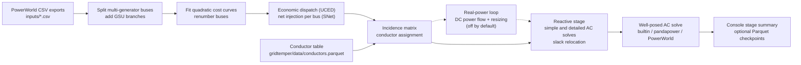

# GridTemper

**GridTemper** takes a raw synthetic power-system case and *tempers* it —
repeated cycles of economic dispatch, conductor sizing, DC/AC power flow, and
reactive-power placement until the case is solvable and physically realistic.
The default configuration is the **TX-2030** synthetic Texas grid (~7,100 buses).

It is a Python (3.12+) port of a MATLAB case-update pipeline. The port is an
algorithm-for-algorithm reimplementation with numpy + `scipy.sparse`, validated
stage by stage against MATLAB reference dumps.

> **Further reading.** Module docstrings cite per-algorithm notes
> (`conversion_manual/algorithms/*.md`, a deviations log `DEVIATIONS.md`) that
> are kept with the original MATLAB code and are not part of this repository.
> GridTemper is otherwise self-contained.

## Layout

```
gridtemper/            # the package
├── config.py          # CaseConfig + TemperOptions (all pipeline knobs, typed)
├── grid_model.py      # GridModel: buses/branches/gens/gencost tables + invariants
├── pipeline.py        # GridTemper class — the main.m orchestration, stage by stage
├── io/                # PowerWorld CSV reader + converted-reference-data loaders
├── topology/          # GSU splitting, internal renumbering, incidence matrix
├── dispatch/          # cost-curve fitting, SNet build, economic dispatch (UCED)
├── conductors/        # conductor library, line params (RXB), transformers, resize
├── powerflow/         # Ybus, Newton-Raphson, DC/AC solvers, selectable AC backends
├── refinement/        # real-power loop (dormant) + reactive placement
└── data/              # reference data converted from .mat (parquet)
scripts/
├── convert_mat_data.py  # one-time .mat -> parquet/npz (needs the MATLAB sources)
└── run_tx2030.py        # CLI: build the TX-2030 config and run end-to-end
tests/                 # pytest suite (regression fixtures land in tests/reference/)
matlab_reference/
└── dump_reference.m   # MATLAB script that produces the tests/reference/ dumps
inputs/                # TX-2030 PowerWorld CSV exports (Buses, Branches, ...)
gridtemper.toml        # optional run configuration
```

## Setup

```powershell
python -m uv sync --extra dev   # add --extra gurobi / pandapower / powerworld as needed
```

Optional extras: `gurobi` (primary UCED backend), `pandapower` and `powerworld`
(alternate AC backends), `plot`, `dev` (pytest + ruff). Without gurobipy, or
when its licence cannot solve the model (the size-limited licence bundled with
the pip package is too small for TX-2030), `[dispatch] backend = "auto"` uses
the exact built-in fallback solver and prints a warning.

Without uv:

```powershell
python -m venv .venv
.venv\Scripts\activate
pip install -e ".[dev]"
```

Keep the editable install (`-e`): `CaseConfig.input_dir` is resolved from the
package location, so a regular install cannot find `inputs/`.

## Run

```powershell
python -m uv run python scripts/run_tx2030.py      # full pipeline (builtin AC backend)
python -m uv run pytest -q                          # test suite
```

Input CSVs are read from `inputs/` (see `CaseConfig.input_dir`). A different
case is a different `CaseConfig`, never a code edit. `--checkpoint DIR` writes
per-stage Parquet snapshots.

## Network models

This repository ships the TX-2030 case only as the PowerWorld CSV exports in
`inputs/`; PowerWorld `.PWB` case files are not distributed. Published
synthetic network models (the EPIGRIDS cases) are available from
[WISPO-POP/SyntheticElectricNetworkModels](https://github.com/WISPO-POP/SyntheticElectricNetworkModels).
To run another case, export its buses, branches, generators, cost curves and
demand from PowerWorld in the same CSV layout and point a `CaseConfig` at them.

## AC power-flow backends

The pipeline solves a well-posed AC power flow (slack + PV generators + PQ loads)
with a selectable solver — set `TemperOptions.ac_backend`, the `--ac-backend`
flag, or `[solver] ac_backend` in `gridtemper.toml`:

```powershell
python -m uv run python scripts/run_tx2030.py --ac-backend builtin
python -m uv run python scripts/run_tx2030.py --config gridtemper.toml
```

| Backend | Extra | Status |
|---|---|---|
| `builtin` | — | Solves the full ~7,100-bus case (scipy Newton-Raphson, full complex Jacobian). **Recommended.** |
| `pandapower` | `[pandapower]` | Matches builtin exactly on small/medium cases. The full TX-2030 case does **not** converge in pandapower's NR (a modeling incompatibility with the per-unit synthetic branches); use `builtin` for the full case. |
| `powerworld` | `[powerworld]` | PowerWorld Simulator via SimAuto. **Open mode** (`powerworld_pwb = "<your case>.PWB"`) opens + solves an existing case. **Build mode** (default) creates the processed case from a `.aux` and needs a SimAuto install that permits case creation. |

## Validation & MATLAB parity (optional)

Regression tests compare against stage-by-stage MATLAB dumps in `tests/reference/`,
and `run_tx2030.py --reference-ybus` loads a reference Ybus for bit-for-bit
parity (quirk Q1 / deviation DV10). Those dumps are **gitignored** and are not
shipped; regenerate them from the original MATLAB sources via
`matlab_reference/dump_reference.m` + `scripts/convert_mat_data.py`. Tests that
need a missing dump skip automatically, so the suite runs without them.

Validation highlights against the MATLAB reference: SNet to 1.5e-11 MW, Ybus to 2e-13, DC flows to 5e-10, conductor
assignment exact.

## Status

**Conversion complete.** All active and dormant MATLAB functions are
converted and the pipeline runs end-to-end. Two intentional stubs remain: the
dormant reactive-placement loop (`run_placement_loop=False`) and the missing
`ACAddReactiveSupport` (`add_reactive_support`).

**Known issue (B6):** the final MATLAB-faithful reactive-stage AC power flow does
not converge in the source MATLAB today (reproduced faithfully). This is separate
from the well-posed AC solve above, which the selectable backends make solvable.

## How it works

`scripts/run_tx2030.py` builds the configuration and calls `GridTemper.run()` in
`gridtemper/pipeline.py`. With the default options the run makes one pass through
the stages below. The dashed path is the real-power loop, which is off by default
(`run_real_power_loop=False`).



| Stage (name in the run summary) | Module under `gridtemper/` | What it does |
|---|---|---|
| `load_inputs` | `io/pw_csv.py` | Reads the five PowerWorld CSV exports and adds `Tap`/`Resize` columns to the branch table. |
| `split_gsus` | `topology/gsu_split.py` | Gives each generator on a multi-generator bus its own bus and a GSU branch. Only the first 88 unique generator bus numbers are candidates (`CaseConfig.gsu_split_first_n_buses`). |
| `fit_costs` | `dispatch/cost_curves.py` | Fits `A + B·P + C·P²` to each generator's 10-point PowerWorld cost curve. |
| `renumber` | `topology/numbering.py` | Maps PowerWorld bus numbers to 0-based internal ids. |
| `build_snet` | `dispatch/snet.py`, `dispatch/uced.py` | Economic dispatch with reserve-based decommitment against total real-power demand (gurobipy when available, otherwise a built-in solver), then generation minus load per bus. |
| `build_incidence` | `topology/incidence.py` | Builds the branch-bus incidence matrix. |
| `assign_conductors` | `conductors/library.py` | For lines with `Resize == 1` and `Tap == 0`, picks the conductor whose MVA rating is nearest the per-circuit rating. |
| `real_power_loop` | `refinement/real_power.py` | Skipped by default. When enabled: DC power flow, line parameters, transformer sizing and branch resizing. |
| `reactive_placement` | `refinement/reactive.py` | Caps line charging `B` at 1, runs the MATLAB-faithful simple AC power flow (one slack, all other buses PV) and the detailed AC solve, and also marks the largest generator's bus as a slack bus. The placement loop itself is dormant. |
| `ac_solve` | `powerflow/backends/` | Builds a well-posed case (one slack, committed generators PV, loads PQ) and solves it with the selected backend. |

## Running: details

Run from the repo root. The input CSVs and reference data are located from the
package folder, but the `--config` and `--checkpoint` paths, and a relative
`powerworld_pwb` path, are taken as written.

1. Full pipeline, builtin AC backend:
   `python -m uv run python scripts/run_tx2030.py`
2. Same run with per-stage Parquet snapshots:
   `python -m uv run python scripts/run_tx2030.py --checkpoint checkpoints`
3. Tests: `python -m uv run pytest -q`

With a `.venv` activated, drop the
`python -m uv run` prefix (`python scripts/run_tx2030.py`, `pytest -q`).

| Option of `scripts/run_tx2030.py` | Effect |
|---|---|
| `--ac-backend {builtin,pandapower,powerworld}` | AC solver for the final solve. Overrides the value from `--config`. |
| `--config FILE` | Reads `[solver] ac_backend, newton_damping, powerworld_pwb`, `[case] slack_bus, rng_seed` and `[dispatch] backend, reserve` from a TOML file such as `gridtemper.toml`. Other keys are ignored. |
| `--reference-ybus` | Uses `tests/reference/ybus_new.npz` instead of the computed Ybus in the reactive stage's simple AC solve (MATLAB parity). Exits with an error if the file is missing. |
| `--checkpoint DIR` | Writes Parquet snapshots under `DIR`. |

PowerWorld open mode: uncomment `powerworld_pwb` in `gridtemper.toml` and run
`python -m uv run python scripts/run_tx2030.py --config gridtemper.toml --ac-backend powerworld`.
The path is handed to SimAuto unchanged; give a full path if SimAuto cannot
find the case. In open mode the reported solution is that of the opened `.PWB`
case, not of the case GridTemper built.

If the selected backend cannot run (for example pandapower is not installed),
the run still finishes and the `ac_solve` line of the summary reads
`<backend> unavailable: <error>`.

### Optional: regenerate the MATLAB reference dumps

This needs MATLAB and the original MATLAB case-update code (not public).

1. In the MATLAB Command Window (edit both paths):

   ```matlab
   cd 'C:\path\to\TX-2030-Case-Updates\Functions'
   addpath('ConductorDataTables'); addpath('C:\path\to\GridTemper\matlab_reference')
   dump_reference
   ```

   Call it as the command `dump_reference`, not through `run(...)` (see the
   script header). The dumps land in `..\python\tests\reference\` relative to
   `Functions\` (see Known issues).
2. Copy that `reference` folder to `tests\reference\` in this repo.
3. Point `FUNCTIONS` in `scripts/convert_mat_data.py` at the MATLAB
   `Functions` folder, then from the repo root run
   `python -m uv run python scripts/convert_mat_data.py`. It rewrites
   `gridtemper/data/*.parquet` and writes `tests/reference/ybus_new.npz`.

## Inputs and outputs

Inputs:

- `inputs/Buses.csv`, `Branches.csv`, `GenBuses.csv`, `GenCostCurves.csv`,
  `Demand_onetimepoint.csv`: PowerWorld CSV exports of the TX-2030 case (file
  names set in `CaseConfig`).
- `inputs/Generator Dispatch_10am.csv` is in the folder but is not read by the
  Python code.
- `gridtemper/data/conductors.parquet`: conductor table for `assign_conductors`.
  `gmd_tables.parquet`, `gmd_xd.parquet`, `xf_data.parquet` and `xf_xr.parquet`
  are read only by the real-power loop (and by the tests).
- `gridtemper.toml` (optional, through `--config`).
- `tests/reference/` (optional, gitignored): MATLAB dumps for the regression
  tests and `--reference-ybus`.

Outputs:

- Console: one summary line per stage, the final bus and branch counts, the
  dispatch objective, and the AC backend result (converged flag, losses).
- With `--checkpoint DIR`: `DIR/<stage>/` holds `buses`, `branches`, `gens`,
  `gencost` and `demand` as `.parquet` after the `split_gsus`, `renumber`,
  `assign_conductors` and `reactive_placement` stages.
- Nothing else is written by default. In build mode the `powerworld` backend
  writes a temporary `.aux` file to the system temp folder and deletes it.

## Data sources

The data in `inputs/` and `gridtemper/data/` are licensed under CC BY 4.0 (see
[LICENSE-DATA](LICENSE-DATA)); the original sources keep their own terms.

| Files | Contents | Original source |
|---|---|---|
| `inputs/*.csv` | TX-2030 case: buses, branches, generators, cost curves, demand | 2030 version of Texas A&M's synthetic Texas7k grid (Texas7k 2030 PowerWorld cases) |
| `gridtemper/data/conductors.parquet`, `gmd_*.parquet` | Conductor catalogue and conductor-spacing (GMD) tables | Dissertation conductor tables |
| `gridtemper/data/xf_*.parquet` | Typical transformer reactances and X/R ratios | Rule-of-thumb tables from the dissertation |

## Known issues

In addition to B6 (see Status above):

- `matlab_reference/dump_reference.m` writes to `..\python\tests\reference\`
  relative to the MATLAB `Functions\` folder (the original repository layout).
  Copy the output into this repo's `tests/reference/`, or edit `outdir` before
  running it.
- `gridtemper.toml` describes `newton_damping` as the builtin backend's
  under-relaxation, but the `builtin` backend always takes a full Newton step
  (damping 1.0). The value only changes the reactive-stage AC solves
  (`TemperOptions.newton.damping`, default 0.1).

## License

* Code: MIT — see [LICENSE](LICENSE).
* Data in `inputs/` and `gridtemper/data/`: CC BY 4.0 — see
  [LICENSE-DATA](LICENSE-DATA).

Copyright (c) 2026 Jonathan M. Snodgrass. Citation details are in
[CITATION.cff](CITATION.cff).

## Acknowledgment

The MATLAB code that GridTemper ports to Python was developed with support from
the Advanced Research Projects Agency-Energy (ARPA-E), U.S. Department of
Energy, under Award Number DE-AR0000717 (EPIGRIDS, GRID DATA program).

**Disclaimer.** This software was prepared as an account of work sponsored by
an agency of the United States Government. Neither the United States
Government nor any agency thereof, nor any of their employees, makes any
warranty, express or implied, or assumes any legal liability or responsibility
for the accuracy, completeness, or usefulness of any information, apparatus,
product, or process disclosed, or represents that its use would not infringe
privately owned rights. Reference herein to any specific commercial product,
process, or service by trade name, trademark, manufacturer, or otherwise does
not necessarily constitute or imply its endorsement, recommendation, or
favoring by the United States Government or any agency thereof. The views and
opinions of authors expressed herein do not necessarily state or reflect those
of the United States Government or any agency thereof.

## Related repositories

- [WISPO-POP/SyntheticElectricNetworkModels](https://github.com/WISPO-POP/SyntheticElectricNetworkModels):
  published synthetic network models to temper.
- [GridForge](https://github.com/Snodgrass-Research-Group/GridForge-Public),
  [GridCrucible](https://github.com/Snodgrass-Research-Group/GridCrucible-Public),
  [GridWeld](https://github.com/Snodgrass-Research-Group/GridWeld-Public) and
  [LoadSmith](https://github.com/Snodgrass-Research-Group/LoadSmith-Public):
  the rest of the synthetic-grid family. `gridtemper/config.py` follows
  GridCrucible's `CaseConfig`/options convention.
